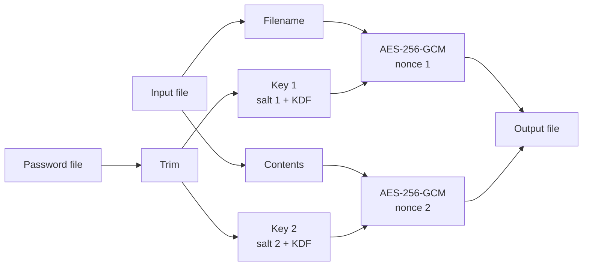

<div align="center">

# pbe-wallet

**A tiny Rust CLI for password-based encryption of files — contents _and_ filenames.**


</div>

---

## Table of Contents

- [Features](#features)
- [Quick Start](#quick-start)
- [Usage](#usage)
- [Examples](#examples)
- [How It Works](#how-it-works)
- [File Format](#file-format)
- [Tips & Caveats](#tips--caveats)
- [Known Issues](#known-issues)
- [License](#license)

---

## Features

|                            |                                                                               |
| -------------------------- | ----------------------------------------------------------------------------- |
| **Strong encryption**      | AES-256-GCM authenticated encryption — tampering is detected                  |
| **Modern key derivation**  | Argon2id by default (256 MiB, 3 passes, 4 lanes); PBKDF2 kept for older files |
| **Filename encryption**    | The original filename is encrypted too, with its own salt and nonce           |
| **Any file as a password** | Use a text file, `LICENSE`, even `main.rs` — its content is the password      |
| **Memory hygiene**         | Derived keys are wiped from memory after use (`zeroize`)                      |
| **Small binary**           | Release build uses LTO and `opt-level = "z"`                                  |

---

## Quick Start

```bash
# 1. Build (release mode recommended)
cargo b --release

# 2. Encrypt
./target/release/pbe-wallet -p ./password.txt -i ./secret.txt -e

# 3. Decrypt
./target/release/pbe-wallet -p ./password.txt -i ./secret.txt -d
```

> [!WARNING]
> Without `-o`, the **input file is overwritten**. Keep a backup until you've confirmed you can decrypt it.

---

## Usage

```text
pbe-wallet -p <PASSWORD_FILE> -i <INPUT> (-e | -d) [-o <OUTPUT>] [-v <VERSION>]
```

| Flag | Long form         | Required | Description                                      |
| :--: | ----------------- | :------: | ------------------------------------------------ |
| `-p` | `--password-file` |   yes    | Path to the file whose content is the password   |
| `-i` | `--input`         |   yes    | Path to the file to encrypt / decrypt            |
| `-e` | `--encrypt`       |  one of  | Encrypt mode                                     |
| `-d` | `--decrypt`       |  one of  | Decrypt mode                                     |
| `-o` | `--output`        |    no    | Output path — defaults to overwriting the input  |
| `-v` | —                 |    no    | Key-derivation version (see below) — default `2` |
| `-h` | `--help`          |    no    | Show help                                        |
| `-V` | —                 |    no    | Show program version                             |

### Key-derivation versions

|      `-v`       | Algorithm          | Parameters                          | When to use                               |
| :-------------: | ------------------ | ----------------------------------- | ----------------------------------------- |
| `2` _(default)_ | **Argon2id**       | 256 MiB memory · 3 passes · 4 lanes | All new files                             |
|       `1`       | PBKDF2-HMAC-SHA256 | 1,000,000 iterations                | Files encrypted before Argon2id was added |
|      other      | PBKDF2 (fallback)  | same as `1`                         | —                                         |

### Password file rules

- The whole file is read as **UTF-8 text**.
- Leading and trailing whitespace is **trimmed**.
- It must **not be empty** after trimming.
- Any file works — but if it changes even by one byte, you can't decrypt anymore.

---

## Examples

**Encrypt / decrypt in place**

```bash
./pbe-wallet -p ./password.txt -i ./secret.txt -e
./pbe-wallet -p ./password.txt -i ./secret.txt -d
```

**Use any file as the password**

```bash
./pbe-wallet -p ./LICENSE -i ./Cargo.toml -e
./pbe-wallet -p ./LICENSE -i ./Cargo.toml -d
```

**Write to a separate output file**

```bash
./pbe-wallet -p ./password.txt -i ./secret.txt -o ./secret.enc -e
./pbe-wallet -p ./password.txt -i ./secret.enc -o ./secret.txt -d
```

**Decrypt an older (PBKDF2) file**

```bash
./pbe-wallet -p ./password.txt -i ./old-secret.txt -d -v 1
```

**Encrypt a whole folder**

```bash
for f in my-secret-folder/*; do
  ./pbe-wallet -p ./password.txt -i "$f" -e
done
```

---

## How It Works

### Encrypt



1. Read and trim the password file.
2. Read the whole input file into memory.
3. **Filename** → random 16-byte salt → derive 32-byte key → AES-256-GCM with random 12-byte nonce.
4. **Contents** → same process with a **new** salt and nonce.
5. Write everything to the output (or overwrite the input) and `fsync` to disk.

### Decrypt

1. Read the password file and the encrypted file.
2. Parse the header, checking lengths at every step.
3. Derive key 1 → decrypt the filename → it must be valid UTF-8.
4. Derive key 2 → decrypt the contents.
5. Write the plaintext to the output (or overwrite the input).

> [!NOTE]
> The decrypted filename is only used as an **integrity check** — the output file is _not_ renamed back to its original name.

If the password or version is wrong, or the file was modified, GCM authentication fails and nothing is written:

```text
Decryption failed: "Failed to decrypt filename"
```

---

## File Format

All integers are **little-endian**.

```text
┌──────────────┬──────────────┬───────────────┬──────────────────────┐
│ salt 1 (16B) │ nonce 1 (12B)│ name len (u32)│ encrypted filename   │
├──────────────┼──────────────┼───────────────┼──────────────────────┤
│ salt 2 (16B) │ nonce 2 (12B)│ data len (u64)│ encrypted contents   │
└──────────────┴──────────────┴───────────────┴──────────────────────┘
```

|  #  | Field                                | Size            |
| :-: | ------------------------------------ | --------------- |
|  1  | Salt (filename)                      | 16 bytes        |
|  2  | Nonce (filename)                     | 12 bytes        |
|  3  | Encrypted filename length            | 4 bytes · `u32` |
|  4  | Encrypted filename + 16-byte GCM tag | variable        |
|  5  | Salt (contents)                      | 16 bytes        |
|  6  | Nonce (contents)                     | 12 bytes        |
|  7  | Encrypted contents length            | 8 bytes · `u64` |
|  8  | Encrypted contents + 16-byte GCM tag | variable        |

> [!IMPORTANT]
> The KDF version is **not stored** in the file. Always decrypt with the same `-v` you used to encrypt.

---

## Tips & Caveats

- **Layered encryption** — you can encrypt a file multiple times, but you must decrypt it the same number of times, in reverse order, with the same passwords and versions.
  > _"Doesn't matter how many N times you encrypt — you'll need N times to decrypt it back."_
- **Memory use** — the whole file is loaded into RAM, and Argon2id uses ~256 MiB per key derivation (two per file). Expect each run to take a moment.
- **Backups** — without `-o` the input is overwritten. Keep a copy until decryption is confirmed.
- **Password files** — store them somewhere safe and never commit them to git.

---

## Known Issues

<details>
<summary><b>Debug build panics on startup</b></summary>

<br/>

Running a debug build (`cargo run` / `cargo b`) panics with:

```text
Argument names must be unique, but 'version' is in use by more than one argument or group
```

The `-v, --version` option clashes with clap's built-in `--version` flag. Release builds skip that check and work normally — build with `--release` and use the short form `-v <N>`.

</details>

---

## License

Released under the **MIT License**. See [LICENSE](LICENSE) for details.
